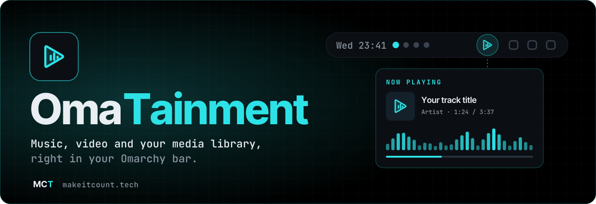
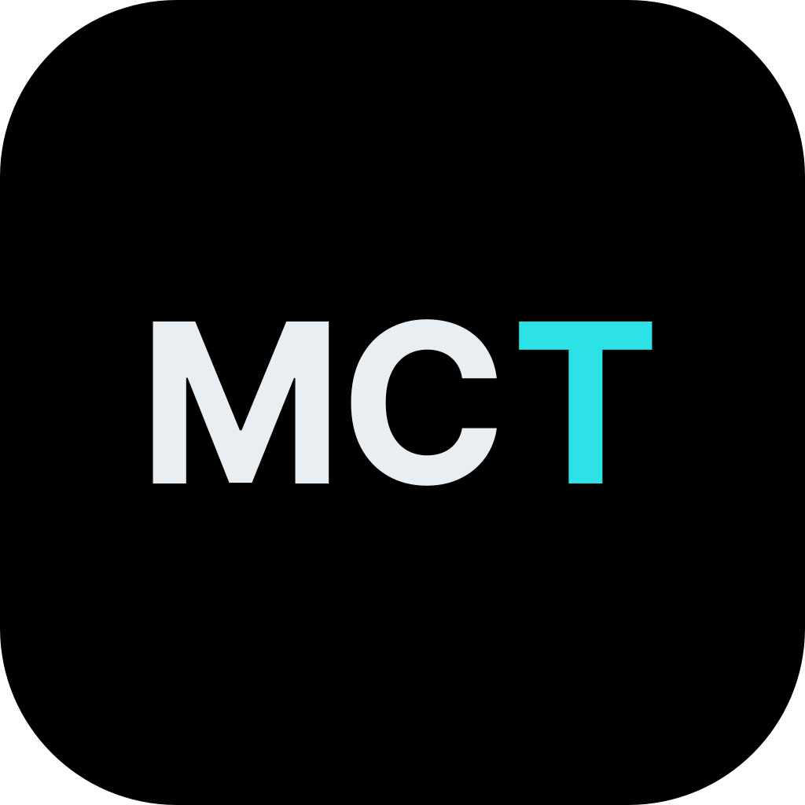

<p align="center">
  
</p>

<p align="center">
  <a href="LICENSE"></a>
  
  
  
  <a href="https://github.com/makeitcounttech/omatainment/stargazers"></a>
</p>

<p align="center">
  <b>Music, YouTube, movies and series, one click away in your top bar.</b><br>
  No heavy browser tabs. No extra windows to juggle.
</p>

---

## ✦ What it does

OmaTainment turns the Omarchy bar into your **entertainment hub**. Search a song, queue a YouTube video, or open a film from your own library, then pop it out, go fullscreen or hand it to your phone.

<table>
<tr>
<td width="50%" valign="top">

### 🎵 Music
YouTube music with **instant search**, a **queue**, **favourites** and continuous autoplay. A live **spectrum visualizer** dances along in the panel.

### 📺 YouTube video
Play videos in a **pop-out** player or **fullscreen** on any monitor, with clean on-screen controls.

### 🎬 Movies & series
Browse your **Remux / Jellyfin-style library**, pick a source, and let **automatic failover** skip links that aren't ready yet.

</td>
<td width="50%" valign="top">

### 📱 Phone hand-off
Send what's playing to your phone and keep watching on the couch. It works over your own trusted connection.

### ⚡ Lightweight by design
Built on **mpv** and native Quickshell/QML, it lives in the bar instead of a browser. The icon even reacts: it shows equalizer bars while music plays and breathes while a video runs.

### 🔐 Your media, your config
Library credentials stay in your own private config file, never inside the plugin.

</td>
</tr>
</table>

## ⚡ Quick start

```bash
# Dependencies (Arch / Omarchy)
sudo pacman -S --needed mpv yt-dlp ffmpeg pipewire python-numpy

# Install the plugin (back up any existing copy first)
mkdir -p ~/.config/omarchy/plugins/empire.omatainment
git clone https://github.com/makeitcounttech/omatainment.git /tmp/omatainment
rsync -a --exclude '.git' --exclude '.github' --exclude 'scripts' --exclude 'tests' \
  /tmp/omatainment/ ~/.config/omarchy/plugins/empire.omatainment/
```

Then open **Omarchy → Plugins**, enable **OmaTainment**, and click the ▶ icon in your bar.

<details>
<summary><b>Optional: connect your media library</b></summary>

Create `~/.config/omatainment/remux.json` (keep it private, outside any repo):

```json
{ "url": "https://media.example.com", "token": "YOUR-API-TOKEN", "userId": "YOUR-USER-ID" }
```
</details>

<details>
<summary><b>Optional: phone hand-off</b></summary>

Set `OMATAINMENT_REMOTE_SSH` (for example `alice@example.com`) and `OMATAINMENT_REMOTE_REMUX` (a loopback URL such as `http://127.0.0.1:8096`). Hand-off refuses to run before reading any credentials if a destination is missing or looks unsafe. Only point it at a machine you trust.
</details>

## 🧩 Requirements

| | |
|---|---|
| **Desktop** | [Omarchy](https://omarchy.org) 4.x (Hyprland + Quickshell, QtMultimedia) |
| **Playback** | mpv, yt-dlp, ffmpeg, PipeWire (`pw-cat`) |
| **Optional** | NumPy (visualizer), a Remux/Jellyfin-compatible server, KDE Connect |

Only play content you have the rights to access.

<details>
<summary><b>Development checks</b></summary>

```bash
bash scripts/privacy-scan.sh
python -B scripts/lint.py
python -B -m unittest discover tests
gitleaks dir . --redact
```
</details>

## 💜 Credits & license

OmaTainment started as a fork of [**omaopus**](https://github.com/MaenExists/omaopus) by MaenExists. Huge thanks for the foundation. We extended it with video, movies & series, failover, pop-out playback and phone hand-off.

MIT. The original copyright notice is kept in [LICENSE](LICENSE). Extensions © [makeitcount.tech](https://makeitcount.tech).

---

<p align="center">
  <a href="https://makeitcount.tech"></a><br>
  <sub><b>Build a digital life you control.</b> · More from us: <a href="https://github.com/makeitcounttech/omarouting">OmaRouting</a></sub>
</p>
